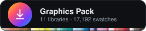
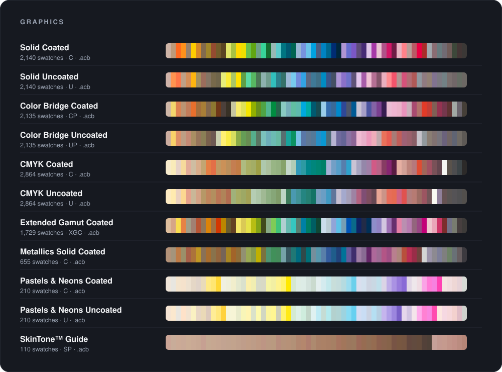
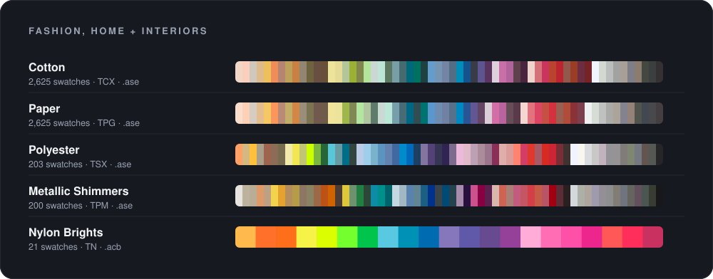

<div align="center">

<a href="https://github.com/abdullah-al-faahim/PANTONE-colorbooks/releases/latest/download/PANTONE-Color-Books.zip">
  
</a>

<br>


<br>


### Bring the PANTONE® color books back to Adobe Illustrator.

**16 ready-to-install libraries** for Graphics and Fashion, Home + Interiors,<br>**22,866 swatches**, one ZIP and two minutes to install.

<br>

<p>
  <a href="https://github.com/abdullah-al-faahim/PANTONE-colorbooks/releases/latest/download/PANTONE-Color-Books.zip"></a>
</p>

<p>
  <a href="https://github.com/abdullah-al-faahim/PANTONE-colorbooks/releases/latest/download/PANTONE-Graphics.zip"></a>&nbsp;&nbsp;<a href="https://github.com/abdullah-al-faahim/PANTONE-colorbooks/releases/latest/download/PANTONE-Fashion-Home-Interiors.zip"></a>
</p>

<sub>Button not working? Grab the <a href="https://github.com/abdullah-al-faahim/PANTONE-colorbooks/archive/refs/heads/main.zip">full repository ZIP</a> instead.</sub>

<br><br>

[**Libraries**](#-whats-inside) &nbsp;•&nbsp; [**Install**](#-installation) &nbsp;•&nbsp; [**Repository layout**](#-repository-layout) &nbsp;•&nbsp; [**FAQ**](#-faq) &nbsp;•&nbsp; [**Disclaimer**](#%EF%B8%8F-disclaimer)

</div>

<br>

## ✨ Why this exists

Since late 2022 most PANTONE color books are no longer bundled with Adobe Creative Cloud apps.
Opening older artwork can show Pantone swatches as **black**, and the familiar
*Swatches › Color Books* menu comes up short. This repository collects the libraries in one place,
organized and packed so you can drop them straight into Illustrator 2024, 2025 and newer.

- 🎨 **Graphics** – Solid, Color Bridge, CMYK, Extended Gamut, Metallics, Pastels & Neons, SkinTone™
- 🧵 **Fashion, Home + Interiors** – Cotton TCX, Paper TPG, Polyester TSX, Metallic Shimmers TPM, Nylon Brights TN
- 📦 **One-click ZIP** – rebuilt automatically every time a library changes
- 💻 **Cross-platform** – identical files work on Windows and macOS

<br>

## 🎨 What's inside

<p align="center">
  
</p>

| Library | Suffix | Swatches | Format | Use it for | File |
|:--|:--:|--:|:--:|:--|:--:|
| **Solid Coated** | `C` | 2,140 | `.acb` | Core PMS spot colors on coated stock | [⬇ 52 KB](https://github.com/abdullah-al-faahim/PANTONE-colorbooks/raw/main/color-books/graphics/PANTONE%20Solid%20Coated-V4.acb) |
| **Solid Uncoated** | `U` | 2,140 | `.acb` | Core PMS spot colors on uncoated stock | [⬇ 52 KB](https://github.com/abdullah-al-faahim/PANTONE-colorbooks/raw/main/color-books/graphics/PANTONE%20Solid%20Uncoated-V4.acb) |
| **Color Bridge Coated** | `CP` | 2,135 | `.acb` | Spot colors matched to CMYK process | [⬇ 56 KB](https://github.com/abdullah-al-faahim/PANTONE-colorbooks/raw/main/color-books/graphics/PANTONE%20Color%20Bridge%20Coated-V4.acb) |
| **Color Bridge Uncoated** | `UP` | 2,135 | `.acb` | Spot colors matched to CMYK process | [⬇ 56 KB](https://github.com/abdullah-al-faahim/PANTONE-colorbooks/raw/main/color-books/graphics/PANTONE%20Color%20Bridge%20Uncoated-V4.acb) |
| **CMYK Coated** | `C` | 2,864 | `.acb` | Process-color builds for coated stock | [⬇ 86 KB](https://github.com/abdullah-al-faahim/PANTONE-colorbooks/raw/main/color-books/graphics/PANTONE%20CMYK%20Coated.acb) |
| **CMYK Uncoated** | `U` | 2,864 | `.acb` | Process-color builds for uncoated stock | [⬇ 86 KB](https://github.com/abdullah-al-faahim/PANTONE-colorbooks/raw/main/color-books/graphics/PANTONE%20CMYK%20Uncoated.acb) |
| **Extended Gamut Coated** | `XGC` | 1,729 | `.acb` | 7-color CMYK + OGV process | [⬇ 49 KB](https://github.com/abdullah-al-faahim/PANTONE-colorbooks/raw/main/color-books/graphics/PANTONE%20Extended%20Gamut%20Coated.acb) |
| **Metallics Solid Coated** | `C` | 655 | `.acb` | Metallic spot colors | [⬇ 17 KB](https://github.com/abdullah-al-faahim/PANTONE-colorbooks/raw/main/color-books/graphics/PANTONE%20Metallics%20Solid%20Coated.acb) |
| **Pastels & Neons Coated** | `C` | 210 | `.acb` | Soft pastels and fluorescent neons | [⬇ 5 KB](https://github.com/abdullah-al-faahim/PANTONE-colorbooks/raw/main/color-books/graphics/PANTONE%20Pastels%20%26%20Neons%20Coated.acb) |
| **Pastels & Neons Uncoated** | `U` | 210 | `.acb` | Soft pastels and fluorescent neons | [⬇ 5 KB](https://github.com/abdullah-al-faahim/PANTONE-colorbooks/raw/main/color-books/graphics/PANTONE%20Pastels%20%26%20Neons%20Uncoated.acb) |
| **SkinTone™ Guide** | `SP` | 110 | `.acb` | Real human skin tones | [⬇ 3 KB](https://github.com/abdullah-al-faahim/PANTONE-colorbooks/raw/main/color-books/graphics/PANTONE%20SkinTone%28TM%29%20Guide.acb) |

<p align="center">
  
</p>

| Library | Suffix | Swatches | Format | Use it for | File |
|:--|:--:|--:|:--:|:--|:--:|
| **Cotton** | `TCX` | 2,625 | `.ase` | FHI colors dyed on cotton | [⬇ 169 KB](https://github.com/abdullah-al-faahim/PANTONE-colorbooks/raw/main/color-books/fashion-home-interiors/PANTONE%28R%29%20F%2BH%20cotton%20TCX.ase) |
| **Paper** | `TPG` | 2,625 | `.ase` | FHI colors printed on paper | [⬇ 169 KB](https://github.com/abdullah-al-faahim/PANTONE-colorbooks/raw/main/color-books/fashion-home-interiors/PANTONE%28R%29%20FHI%20Paper%20TPG.ase) |
| **Polyester** | `TSX` | 203 | `.ase` | FHI colors on polyester | [⬇ 13 KB](https://github.com/abdullah-al-faahim/PANTONE-colorbooks/raw/main/color-books/fashion-home-interiors/PANTONE%28R%29%20FHI%20Polyester%20TSX.ase) |
| **Metallic Shimmers** | `TPM` | 200 | `.ase` | FHI metallic shimmer finishes | [⬇ 13 KB](https://github.com/abdullah-al-faahim/PANTONE-colorbooks/raw/main/color-books/fashion-home-interiors/PANTONE%28R%29%20FHI%20Metallic%20Shimmers%20TPM.ase) |
| **Nylon Brights** | `TN` | 21 | `.acb` | Neon brights on nylon | [⬇ 1 KB](https://github.com/abdullah-al-faahim/PANTONE-colorbooks/raw/main/color-books/fashion-home-interiors/PANTONE%28R%29%20F%2BH%20nylon%20brights%20TN.acb) |

<sub>Previews are on-screen approximations converted from the libraries' L\*a\*b\* values. They are not a substitute for a physical guide.</sub>

<br>

## 🚀 Installation

> [!TIP]
> Download **[PANTONE-Color-Books.zip](https://github.com/abdullah-al-faahim/PANTONE-colorbooks/releases/latest/download/PANTONE-Color-Books.zip)** and unzip it first. Close Illustrator before copying files.

### 1 · `.acb` libraries → the *Color Books* menu

Copy every `.acb` file from `graphics/` (and `PANTONE(R) F+H nylon brights TN.acb` from `fashion-home-interiors/`) into Illustrator's **Color Books** folder.

<details open>
<summary><b>🪟 Windows</b></summary>

<br>

```text
C:\Program Files\Adobe\Adobe Illustrator 2024\Presets\en_US\Swatches\Color Books\
```

1. Open the folder above in File Explorer (paste it into the address bar).
2. Paste the `.acb` files and click **Continue** on the administrator prompt.
3. Choose **Replace the files in the destination** if asked.

</details>

<details>
<summary><b>🍎 macOS</b></summary>

<br>

```text
/Applications/Adobe Illustrator 2024/Presets.localized/en_US/Swatches/Color Books/
```

1. In Finder press <kbd>⇧ Shift</kbd> + <kbd>⌘ Cmd</kbd> + <kbd>G</kbd> and paste the path above.
2. Drag the `.acb` files in and enter your password when prompted.
3. Choose **Replace** if asked.

</details>

> [!NOTE]
> Replace `2024` with your version (`2025`, `2026`, …) and `en_US` with your language folder (`en_GB`, `de_DE`, `fr_FR`, …).
> Installed several versions? Repeat for each one.

Start Illustrator and open **Window › Swatches › ☰ › Open Swatch Library › Color Books**. 🎉

### 2 · `.ase` libraries → any Adobe app

The Fashion, Home + Interiors `.ase` files load on demand and need no copying:

**Window › Swatches › ☰ › Open Swatch Library › Other Library…** → pick the `.ase` file.

<br>

## 🗂 Repository layout

```text
PANTONE-colorbooks/
├── color-books/
│   ├── graphics/                   11 × .acb  · Solid, Color Bridge, CMYK, XG, Metallics, Pastels & Neons, SkinTone
│   ├── fashion-home-interiors/      4 × .ase + 1 × .acb  · TCX, TPG, TSX, TPM, TN
│   └── README.md                   Install guide (also shipped inside the ZIP)
├── assets/                         README artwork: banner, galleries, download buttons
├── scripts/
│   ├── colorbooks.py               Reader for .acb / .ase files
│   └── build_assets.py             Regenerates everything in assets/
└── .github/workflows/
    └── release-zip.yml             Builds the ZIPs and publishes them to the latest release
```

<details>
<summary><b>How the download button works</b></summary>

<br>

Each push that touches `color-books/` runs the **Build download ZIPs** workflow. It packs the libraries into

| ZIP | Contents |
|:--|:--|
| `PANTONE-Color-Books.zip` | Everything |
| `PANTONE-Graphics.zip` | `graphics/` |
| `PANTONE-Fashion-Home-Interiors.zip` | `fashion-home-interiors/` |

and publishes them to the `colorbooks-latest` release. The buttons point at
`releases/latest/download/<file>.zip`, so they always serve the newest build. You can also run the
workflow by hand from the **Actions** tab.

</details>

<details>
<summary><b>Adding or updating a library</b></summary>

<br>

1. Drop the `.acb` / `.ase` file into the right folder under `color-books/`.
2. Add it to `CATALOG` in [`scripts/build_assets.py`](scripts/build_assets.py).
3. Regenerate the artwork (Python 3.10+, no dependencies) and update the tables above:

   ```bash
   python scripts/build_assets.py
   ```

4. Commit and push; the ZIPs rebuild on their own.

</details>

<br>

## 💬 FAQ

<details>
<summary><b>My Pantone swatches still show as black.</b></summary>

<br>

Install the `.acb` files as shown above, restart Illustrator, then re-apply the colors from
**Open Swatch Library › Color Books**. Swatches already embedded in a document keep their old values
until you replace them.
</details>

<details>
<summary><b>Which library should I pick?</b></summary>

<br>

- Printing spot inks on coated paper → **Solid Coated** (`C`); uncoated → **Solid Uncoated** (`U`).
- Printing CMYK but want to stay close to a spot color → **Color Bridge** (`CP` / `UP`).
- Designing for textiles, fashion or interiors → **Cotton TCX** or **Paper TPG**.
</details>

<details>
<summary><b>Do they work in Photoshop or InDesign?</b></summary>

<br>

`.ase` files load in Photoshop, InDesign and Illustrator through the Swatches panel.
`.acb` files can also go into Photoshop's own `Presets/Color Books` folder.
</details>

<details>
<summary><b>Will this work with Illustrator 2023 or older?</b></summary>

<br>

Most likely yes: the `.acb` and `.ase` formats haven't changed. The install paths above are written for 2024 and newer.
</details>

<br>

## ⚖️ Disclaimer

PANTONE® and other Pantone trademarks are the property of **Pantone LLC**. Adobe® and Illustrator® are
trademarks of **Adobe Inc.** This project is an independent, community-maintained collection and is
**not affiliated with, endorsed by, or sponsored by** Pantone or Adobe.

The libraries are provided as-is for convenience and education. On-screen colors are approximations;
for color-critical production work, verify against current physical PANTONE guides or a licensed
[Pantone Connect](https://www.pantone.com/pantone-connect) subscription. You are responsible for
making sure your use complies with Pantone's licensing terms.

<br>

<div align="center">

**If this saved you time, leave a ⭐. It helps other designers find it.**

Made with 🎨 by [**@abdullah-al-faahim**](https://github.com/abdullah-al-faahim)

</div>
